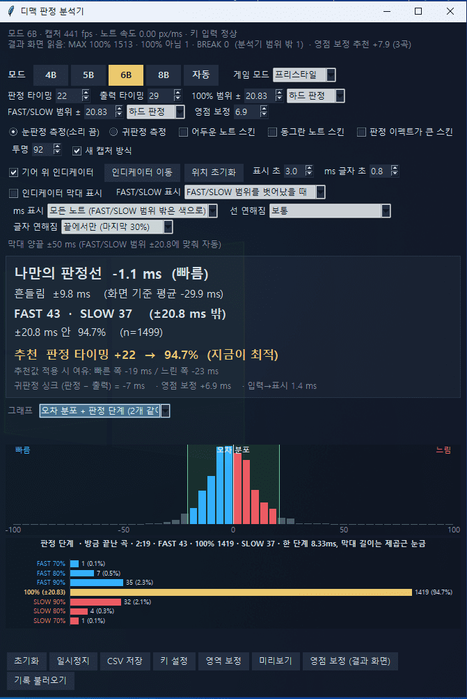
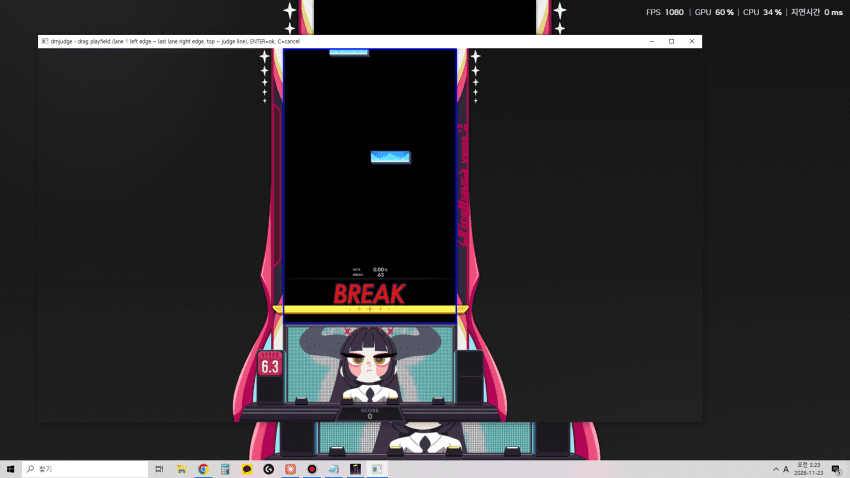
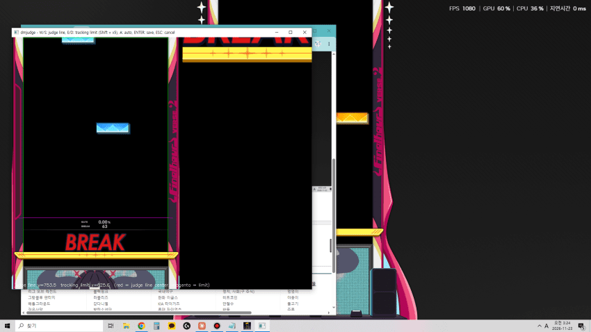

# OBS 디맥냥이 (디맥 판정 분석 + OBS 인디케이터)

**DJMAX RESPECT V**를 플레이하는 동안, 노트 하나하나를 **몇 ms 빨리/늦게 쳤는지** 실시간으로 보여주는 프로그램입니다.

클로드를 갈궈서 만든 베타버전이라 다양한 찐빠가 날 수 있습니다.

화면을 캡쳐해서 판정범위를 추천해주고, 인디케이터와 패슬은 **OBS(방송·녹화 화면)로만** 보여줍니다.

**OBS판은 게임 화면 위에 아무것도 띄우지 않습니다.** 게임 위에 창을 띄우는 코드(`indicator.py`) 자체가 이 판에는 들어 있지 않고, 분석기 창도 게임 위로 강제로 올라오지 않아요. 인디케이터를 실시간으로 보고 싶으면 OBS 미리보기나 브라우저를 보조 모니터에 띄워 두면 돼요.

기반 자료: 갤러리 글 [「간단하게 판정 맞춰보는법」](https://gall.dcinside.com/mgallery/board/view/?id=djmaxrespect&no=2191967)

- **OBS 브라우저 소스**로 인디케이터를 보내서, 키를 누르는 순간 영점에서 얼마나 벗어났는지 방송·녹화 화면에 보여줍니다.
- 플레이 기록으로 나에게 맞는 **판정 타이밍(눈판정)** 과 **출력 타이밍(귀판정)** 을 추천합니다.
- 곡이 끝나면 **결과 화면 숫자를 자동으로 읽어서** 분석기 판정을 게임 판정에 맞춥니다.

> 비공식 팬 메이드 도구입니다. NEOWIZ / DJMAX 공식과 관련이 없습니다.

> 기어 위에 인디케이터를 직접 띄우는 기존 **디맥냥이**는 여기 → **[DmJudge](https://github.com/rne123/DmJudge)**

### ⬇️ [여기를 눌러 다운로드 (DmJudge-OBS.zip)](https://github.com/rne123/DmJudge-OBS/archive/refs/heads/main.zip)
받은 zip을 압축 풀고 **`INSTALL.bat`** 더블클릭 → 끝! (자세한 건 아래 "설치")

---

## 안전한가요?

- **게임 메모리를 읽지 않고, 게임 파일도 건드리지 않습니다.**
  쓰는 건 딱 두 가지예요: **화면 캡처**(녹화 프로그램과 같은 방식)와 **키 입력**(어떤 키를 언제 눌렀는지).
- 키 입력은 내 PC 안에서 노트와 짝짓는 데만 쓰고, **어디로도 보내지 않습니다.** 분석기는 인터넷을 쓰지 않아요.
  (설치할 때만 파이썬과 부품을 받느라 인터넷을 씁니다)
- **게임 화면 위에 아무것도 띄우지 않습니다.** 인디케이터는 OBS 브라우저 소스로만 나가요.
- exe를 따로 배포하지 않고, 여기 공개된 소스를 **내 PC에서 공식 파이썬으로 그대로 실행**합니다.
- 키 입력은 **디맥 창이 맨 앞에 있을 때, 설정한 게임 키만** 기록합니다. 채팅·비밀번호 같은 다른 키 입력은 기록하지 않아요.
  (Windows가 키보드 입력을 프로그램에 넘겨주는 방식이라 다른 키도 잠깐 들어오지만, 디맥 창이 맨 앞이 아니면 키 입력 프로세스 안에서 바로 버리고(`dmjudge/keys_win.py`), 게임 키가 아니면 그 자리에서 버립니다(`dmjudge/session.py` 의 `on_key`). 디맥 창인지는 맨 앞 창의 **제목**만 보고, 게임 프로세스는 열거나 건드리지 않아요.)
- OBS 인디케이터를 켜면 **내 PC 안에서만** 열리는 주소(`127.0.0.1`)로 그림을 보냅니다. 다른 PC나 인터넷에서는 접속할 수 없어요.
- `INSTALL.bat` 은 이 폴더의 `install.ps1` 을 실행할 뿐이에요. 하는 일: 파이썬이 없으면 공식 패키지 관리자(winget)로 설치 → 이 폴더 안 `.venv` 에 부품 설치 → 바탕화면 바로가기. 메모장으로 열어 직접 확인할 수 있어요.

### 사용 전 주의
- **연습용 도구입니다. 래더·버서스 같은 대전 모드에서는 사용을 권장하지 않아요.**
- 디맥의 보안 프로그램(XIGNCODE)이 PC에서 도는 프로그램에 따라 **"비정상적인 행동" 메시지와 함께 게임을 종료**하는 경우가 있어요. 분석기를 켠 뒤 이런 일이 생기면 분석기를 끄고 **Issues**에 알려 주세요.
- 비공식 도구라 사용으로 생기는 불이익은 책임지지 않습니다.

### 정확도와 한계
- 화면 캡처로 노트를 보고 재는 방식이라, 노트 하나하나에는 **1~2ms 정도의 측정 흔들림**이 있어요. 그래서 판정 경계(예: ±41.67ms) 바로 근처 노트는 게임과 FAST/SLOW가 다르게 나올 수 있어요. 곡 전체 개수는 대체로 맞아요.
- **롱노트를 뗄 때의 판정**(일찍 떼서 뜨는 FAST 등)은 재지 않아요.
- 노트를 가끔 놓치거나, 확실하지 않은 노트는 통계에서 빼요.
- 만든 사람 환경(Windows 10, 1080p, 144Hz, 보더리스)에서 주로 테스트했어요. 다른 해상도·주사율·멀티 모니터에서는 문제가 있을 수 있으니 알려 주세요.

---

## 설치 (처음 한 번, 5~10분)

1. **[여기를 눌러 다운로드](https://github.com/rne123/DmJudge-OBS/archive/refs/heads/main.zip)**
2. 받은 zip 파일을 오른쪽 클릭 → **압축 풀기** → 원하는 곳(예: 바탕화면)에 풀기
3. 풀린 폴더 안의 **`INSTALL.bat`** 더블클릭
   - 파란 창 "Windows의 PC 보호"가 뜨면 → **추가 정보** → **실행**
   - 검은 창이 알아서 다 해요: 파이썬이 없으면 자동 설치 → 필요한 부품 설치 → **바탕화면에 `DmJudge OBS` 바로가기**
   - "설치 끝!"이 나오면 엔터 → 분석기가 켜져요.
4. 다음부터는 **바탕화면의 `DmJudge OBS`** 를 더블클릭하면 돼요.

> 일반판과 같이 쓰고 싶으면 다른 폴더에 풀어서 설치하면 돼요. 설정도 폴더마다 따로 저장돼요.

> 설정과 기록은 **압축을 푼 그 폴더**에 저장돼요. 폴더를 지우지 마세요.
> 설치가 실패하면 그 검은 창을 사진으로 찍어 **Issues**에 올려 주세요.

**분석기 기본 화면**

---

## 사용법

디맥은 **보더리스 창** 으로 켜 주세요. (전체 화면 독점 모드는 캡처가 안 될 수 있어요)

### 1. 영역 보정
곡 시작 직전(노트가 아직 안 나온 화면)에서 **[영역 보정]** 을 누르고,
**파란 영역을 드래그**해서 지시대로 맞춘 뒤 **Enter** 를 눌러 주세요.
(1번 레인 왼쪽 끝 ~ 마지막 레인 오른쪽 끝, 위쪽 ~ 판정선까지)

### 2. 판정선 보정
확대된 판정선의 **정중앙에 빨간 선을 정확히 맞춰** 주세요.
조절은 **W / S** (Shift를 같이 누르면 크게, A = 자동 찾기), 다 맞추면 **Enter**.

맞춘 뒤 **[미리보기]** 로 노트에 초록 테두리가 따라가는지 확인할 수 있어요. (닫기: ESC)

### 3. 모드 설정 (필수)
**4B / 5B / 6B / 8B 버튼 중 지금 치는 모드를 꼭 선택**해 주세요.
자동 판별 기능도 있지만 **권장하지 않아요.**
**[키 설정]** 에서 모드별로 레인마다 키를 바꿀 수 있어요.

<!-- 📷 캡처: 모드 버튼과 키 설정 창 -->

### 4. 영점 보정 (가장 먼저!)
분석기 판정과 **실제 디맥 판정을 일치시키는 작업**이에요. 다른 것보다 **가장 먼저** 해 주세요.
- 곡을 **결과 화면까지 끝까지** 치면 결과 화면 숫자를 자동으로 읽어요.
- 올퍼펙트보다 **MAX 70~90%가 좀 섞인 판을 3곡 이상** 모으는 게 좋아요. (경계 근처 노트가 많을수록 정확해져요)
- 3곡이 모이면 영점 보정값을 추천해 줘요 → **[영점 보정 (결과 화면)]** 창에서 **[추천값 적용]**

<!-- 📷 캡처: 영점 보정(결과 화면) 창 -->

### 5. 판정 타이밍 · 출력 타이밍 맞추기
**인게임 설정과 분석기의 판정 타이밍 · 출력 타이밍 숫자는 반드시 똑같이** 맞춰 주세요.
1. **판정 타이밍 (눈판정)**: 게임 **소리를 끈 상태**에서 치고 → 아래쪽의 **"추천 판정 타이밍"** 으로 조절
2. **출력 타이밍 (귀판정)**: 판정 타이밍을 맞춘 뒤, 설정에서 **"귀판정 측정"** 을 고르고 → **아주 쉬운 곡을 노래만 듣고** 쳐서 → **"추천 출력 타이밍"** 으로 조절

곡마다 새로 재고 싶으면 곡 시작 전에 **[초기화]** 를 눌러 주세요.

### 6. 스킨 옵션
쓰는 스킨에 해당될 때만 체크해 주세요.
- **어두운 노트 스킨**: 어둡거나 반투명한 노트
- **동그란 노트 스킨**: 고리(테두리) 모양 동그란 노트
- **판정 이펙트가 큰 스킨**: 판정선 위로 높이 솟는 판정 이펙트(캔 모양 등)
- 기어(패널) 스킨을 바꾸면 **[영역 보정]** 을 다시 해 주세요.

<!-- 📷 캡처: 스킨 옵션 체크박스 -->

### 7. OBS 인디케이터
1. 분석기 가운데 **[▸ 인디케이터 · OBS · 기타 설정]** 을 눌러 펼치고, **[OBS 인디케이터 (브라우저 소스)]** 가 체크돼 있는지 확인 (기본으로 켜져 있어요) → **[주소 복사]**
2. OBS → 소스 목록 **+** → **브라우저** → URL에 붙여넣기 (`http://127.0.0.1:8777/`)
3. 너비 · 높이는 분석기 아래쪽에 나오는 **"브라우저 소스 크기"** 대로 넣기 (기본은 **원래 디맥냥이 인디케이터와 똑같은 크기**예요. 1080p 기본 기어면 약 225 × 58)
4. OBS 화면에서 기어 위든 옆이든 원하는 곳에 끌어다 두면 끝. 배경은 투명이에요.

- **크기 %**: 100% = 원래 디맥냥이 인디케이터와 똑같은 크기와 모양 (기어 폭 × 45%, 높이 58). 200%면 두 배로 선명하게 그려요. 크기를 바꿀 땐 OBS에서 늘리거나 줄이지 말고 이 숫자를 바꾼 뒤, OBS 소스 크기를 새로 나온 숫자로 맞춰 주세요. OBS에서 줄이면 옅은 선이 지워져서 최신 선만 보여요. (OBS에서 소스 우클릭 → 변환 → 변환 초기화 = 원래 크기)
- **[브라우저로 보기]**: 인터넷 창으로 미리 보기. 보조 모니터에 띄워 두면 플레이 중에도 볼 수 있어요.
- OBS나 브라우저가 연결되지 않은 동안에는 그림을 그리지 않아서 부하가 없어요.
- 주소는 **내 PC 안(`127.0.0.1`)에서만** 열려요. 다른 PC나 인터넷에서는 접속할 수 없어요.

**인디케이터 옵션**
- 막대 없이 **FAST / SLOW 표시만** 쓸 수도 있어요.
- **표시 초**: 인디케이터 막대에 친 노트가 남아 있는 시간
- **ms 글자 초**: FAST / SLOW 글자와 ms 숫자가 사라지는 시간
- **글자 크기 %**: FAST / SLOW 글자와 ms 숫자의 크기 (기본 100%). 글자는 중앙선을 넘지 않게 왼쪽/오른쪽에 나뉘어 표시되고, 자리가 모자라면 자동으로 작아져요.
- **FAST/SLOW 색 반대로**: 기본은 FAST 파랑 / SLOW 빨강이에요. 다른 게임처럼 반대 색이 익숙하면 체크하세요.
- 방금 친 노트는 **굵은 노란 선과 위쪽 작은 점**으로 표시돼요.

<!-- 📷 캡처: OBS에 넣은 인디케이터 -->

### 8. 100% 범위 · FAST/SLOW 범위
- **100% 범위**: 실제 인게임에서 MAX 100%가 뜨는 범위예요. **하드 / 맥스 판정** 으로 칠 때만 바꿔 주세요. (노멀 ±41.67 / 하드 ±20.83 / 맥스 ±10.42)
- **FAST/SLOW 범위**: 내가 원하는 기준으로 정하면 돼요. 연습할 때 좁히면 더 엄격하게 FAST/SLOW가 떠요.

### 9. 통계 그래프와 추천 판정선
- 그래프 메뉴에서 **오차 분포, FAST/SLOW 통계(판정 단계), 곡의 밀도(초당 노트), 판정이 얼마나 튀었는지(곡 흐름)** 를 볼 수 있어요.
- 하단에 통계를 바탕으로 **추천 판정 타이밍** 이 나와요.

<!-- 📷 캡처: 그래프와 추천 판정선 -->

### 10. CSV 저장 · 불러오기
- 곡이 끝나면 **[CSV 저장]** 으로 기록을 저장할 수 있어요.
- **[기록 불러오기]** 로 저장한 CSV를 불러와서 다시 볼 수 있어요.

### 11. 설정 저장
- **저장 버튼은 따로 없어요.** 설정을 바꾸는 즉시 프로그램 폴더의 **`config.json`** 에 자동으로 저장되고, 다음에 켜면 그대로 이어져요.
- `config.json` 에 저장되는 것: 영역 보정(판정선·추적 한계선 위치), 모드·키 설정, 판정 타이밍·출력 타이밍, 영점 보정값, 100% 범위·FAST/SLOW 범위, 인디케이터 옵션, OBS 인디케이터 설정, 스킨 옵션, 고른 그래프, 창 크기·위치
- 같은 폴더의 다른 파일
  - **`results.json`**: 결과 화면에서 읽은 곡 기록(영점 보정 추천에 씀, 최근 120곡)
  - **`.csv` 파일**: [CSV 저장] 으로 저장한 기록 (기본 저장 위치가 프로그램 폴더)
- **백업 / 다른 PC로 옮기기**: `config.json` 과 `results.json` 을 복사해 두었다가 새 폴더에 넣으면 돼요.
- **처음 상태로 되돌리기**: 분석기를 끄고 `config.json` 을 지우면 기본값으로 돌아가요. (영역 보정부터 다시 해 주세요)
- **업데이트** 할 때 새 파일을 덮어써도 이 파일들은 그대로 남아요.
- 분석기를 끈 상태에서 `config.json` 을 메모장으로 열어 직접 고칠 수도 있어요. (고급 설정은 MANUAL.txt 참고)

더 자세한 설명은 **[MANUAL.txt](MANUAL.txt)** 에 있어요.

---

## 업데이트

1. **[다운로드 링크](https://github.com/rne123/DmJudge-OBS/archive/refs/heads/main.zip)** 로 새로 받기
2. 압축을 푼 파일을 **원래 폴더에 덮어쓰기** (설정·기록은 그대로 남아요)
3. **`INSTALL.bat`** 한 번 더 더블클릭 (이번엔 금방 끝나요)

---

## 문제가 생기면 (제보 방법)

1. 분석기에서 **[초기화]** → 문제가 생긴 곡을 한 번 **결과 화면까지** 칩니다.
2. **[CSV 저장]** → 파일 2개가 생깁니다: `이름.csv`, `이름_raw.csv` (게임 키 입력과 노트 인식 기록만 들어 있어요)
3. 이 페이지 위쪽의 **Issues** → **New issue** → 양식에 맞춰 적고 **두 파일을 끌어다 놓아 첨부** 합니다.
   - 가능하면 그 판의 **녹화 영상** 도 같이 (OBS 인디케이터는 기어 밖에 두고 녹화해 주세요)
   - 폴더에 `dumps` 폴더나 `error_log.txt` 가 생겼다면 그것도 같이 주시면 큰 도움이 됩니다.

---

## 개발자용

- 소스 그대로 실행됩니다(별도 빌드 없음). `INSTALL.bat` → `install.ps1` 이 폴더 안에 `.venv`(Python 3.10 이상)를 만들고 `requirements.txt`를 설치한 뒤, `.venv\Scripts\pythonw.exe main.py` 바로가기를 만듭니다.
- 일반판과 코드는 같고 `dmjudge/indicator.py`(게임 위 창)만 빠져 있습니다. `dmjudge/edition.py` 가 이 파일이 없으면 OBS판으로 동작합니다.
- 오류 메시지를 보면서 실행: **`run_dev.bat`** (검은 창). 바로가기로 실행하다 오류가 나면 폴더에 `error_log.txt` 가 남습니다.
- 바로가기 없이 실행: **`START.bat`**
- 사용 라이브러리: numpy, opencv-python, dxcam, pillow

---

## 라이선스

[MIT License](LICENSE) © 2026 nirne

DJMAX RESPECT V 및 관련 상표, 스크린샷 속 게임 화면의 저작권은 NEOWIZ에 있습니다. MIT 라이선스는 이 프로그램의 소스 코드에만 적용됩니다. 이 프로그램은 게임 화면을 분석할 뿐, 게임의 어떤 데이터도 포함하거나 수정하지 않습니다.
